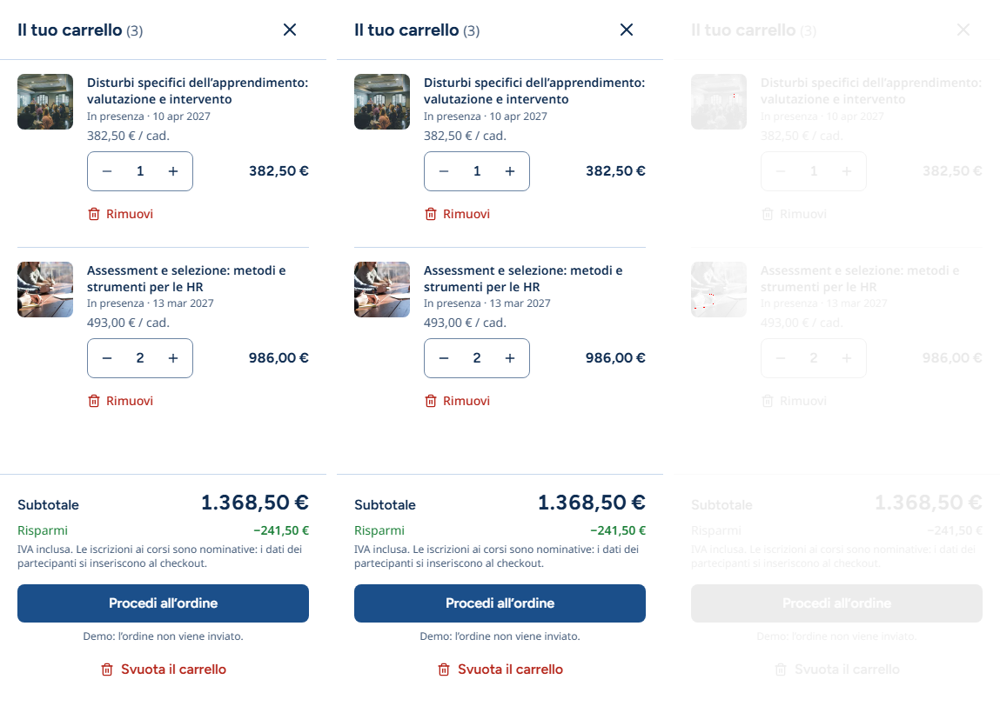
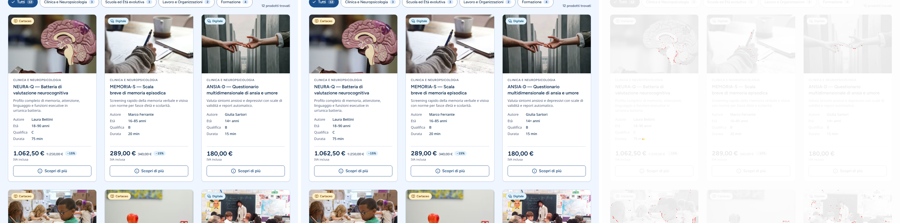

# Paridad visual — version-a (Next.js) frente a version-b (Laravel)

**Fecha:** 2026-11-04 · **Herramienta:** [`tools/parity`](../tools/parity) (Playwright 1.64.1 + pixelmatch 8) ·
**Datos crudos:** [`parity/results.json`](parity/results.json) (píxeles), [`parity/computed.json`](parity/computed.json) (valores computados).

**Conclusión:** en las 39 comparaciones (13 vistas × 3 anchos) la diferencia máxima es **0,09 %** de píxeles y la media
**0,02 %**, muy por debajo del objetivo orientativo de 1,5 %. Las 39 capturas tienen **exactamente el mismo tamaño** en A y B
(por ejemplo, la página completa mide 375×12412, 768×7471 y 1280×5335 en las dos). Con las fotos enmascaradas, todas las vistas
quedan en ≤ 0,04 %. De 1014 valores computados comparados, quedan 3 diferencias, las tres de notación sin efecto visual (§3).
La medición encontró un defecto real, que estaba en **A** y se corrigió (§4.1): el carrito con artículos pasó de 0,13 % a 0,00 %.

---

## 1. Método

`tools/parity/capture.mjs` levanta A (`next start`, build de producción, :3000) y B (`php artisan serve`, :8000) si no están
en marcha y, para cada vista y ancho (375×812, 768×1024, 1280×800):

- abre un **contexto nuevo** (sin `localStorage`: el carrito siempre empieza vacío), `deviceScaleFactor` 1, `locale` it-IT;
- **fija el reloj** (`page.clock.setFixedTime`) y emula `prefers-reduced-motion: reduce` (sin scroll suave);
- **desactiva animaciones y transiciones** con CSS inyectado (`transition/animation: none`, caret oculto) y además
  `animations: 'disabled'` en la captura;
- espera a las **fuentes** (`document.fonts.ready`) y recorre la página para disparar la carga diferida de **todas las
  imágenes**, que espera y decodifica;
- aparca el puntero fuera de la página (ningún hover accidental);
- captura: página completa, recorte de la página completa al elemento (el header sticky queda arriba y no se repinta en medio)
  o la ventana (diálogos modales, que viven en la *top layer*).

Cada vista se captura dos veces por versión:

| Métrica | Qué mide |
|---|---|
| **diff** | % de píxeles distintos (pixelmatch, umbral 0,1, antialiasing ignorado) |
| **sin fotos** | lo mismo con cada `` enmascarada en las dos versiones: queda maquetación, tipografía, color y estados |

La segunda separa lo que B no puede igualar: A recomprime las fotos en AVIF con el optimizador de `next/image` y B las pide a la CDN
de Unsplash (`auto=format`), con otra compresión (ASSUMPTIONS B25).

Las vistas usan solo roles, nombres accesibles e ids comunes (HANDOFF §4), nunca clases de un framework. Definición:
[`tools/parity/views.mjs`](../tools/parity/views.mjs).

### 1.1 ¿Mide algo? Prueba de sensibilidad

Para descartar que los valores bajos sean un fallo de la herramienta, se inyectó en B un defecto de **1 px**
(`.site-header__bar { column-gap: 13px }` en vez de 12, y 19 px de padding en el cuerpo de las cards en vez de 20):

| Vista | 375 | 768 | 1280 |
|---|---|---|---|
| Header | 0,00 % (a 375 no hay hueco entre logo y acciones) | **0,98 %** | **2,15 %** |
| Catálogo (sin fotos) | **8,66 %** · página 24 px más corta | **6,11 %** · 12 px | **4,79 %** · 8 px |

Un píxel de diferencia se detecta y se nota en el tamaño de la captura: la paridad medida es real.

## 2. Resultados por vista y ancho

| Vista | 375 | 768 | 1280 | 375 sin fotos | 768 sin fotos | 1280 sin fotos | Tamaño igual |
|---|---|---|---|---|---|---|---|
| Página completa | 0,07 % | 0,05 % | 0,05 % | 0,01 % | 0,01 % | 0,00 % | sí |
| Header | 0,00 % | 0,04 % | 0,01 % | 0,00 % | 0,04 % | 0,01 % | sí |
| Hero | 0,00 % | 0,00 % | 0,00 % | 0,00 % | 0,00 % | 0,00 % | sí |
| Catálogo — Tutti | 0,09 % | 0,09 % | 0,08 % | 0,01 % | 0,01 % | 0,00 % | sí |
| Catálogo — Formazione | 0,07 % | 0,06 % | 0,04 % | 0,01 % | 0,01 % | 0,00 % | sí |
| Catálogo — sin resultados | 0,00 % | 0,00 % | 0,00 % | 0,00 % | 0,00 % | 0,00 % | sí |
| Diálogo de ficha (NEURA-Q) | 0,05 % | 0,07 % | 0,06 % | 0,01 % | 0,00 % | 0,00 % | sí |
| Carrito vacío | 0,00 % | 0,00 % | 0,00 % | 0,00 % | 0,00 % | 0,00 % | sí |
| Carrito con artículos | 0,00 % | 0,00 % | 0,00 % | 0,00 % | 0,00 % | 0,00 % | sí |
| Formulario vacío | 0,00 % | 0,00 % | 0,00 % | 0,00 % | 0,00 % | 0,00 % | sí |
| Formulario con errores | 0,00 % | 0,00 % | 0,00 % | 0,00 % | 0,00 % | 0,00 % | sí |
| Formulario — éxito | 0,00 % | 0,00 % | 0,00 % | 0,00 % | 0,00 % | 0,00 % | sí |
| Footer | 0,01 % | 0,01 % | 0,01 % | 0,01 % | 0,01 % | 0,01 % | sí |

**Máximo 0,09 % · media 0,02 % · 39 comparaciones · objetivo < 1,50 %: cumplido en todas.**
(«0,00 %» significa menos de 0,005 %: unas decenas de píxeles de antialiasing como mucho.)

## 3. Valores computados

`tools/parity/computed.mjs` compara 33 elementos clave en los tres anchos (1014 valores): `font-family`, tamaño, interlineado,
peso, *tracking* y color de los textos; alto del header; `grid-template-columns`, `column-gap` y `row-gap` de la grilla, la
franja, el contacto y el footer; padding, radio, borde y sombra de botones, pills, badges, campos y cards; posición y tamaño
de cada caja (tolerancia 0,5 px; el resto, igualdad exacta).

| | Diferencias |
|---|---|
| Antes de las correcciones | 9 de 1014 |
| Después | **3 de 1014** |

Las 3 restantes (las mismas en 375, 768 y 1280):

| Elemento | Propiedad | A | B | Por qué no se corrige |
|---|---|---|---|---|
| card | `box-shadow` | 4 capas `rgba(0,0,0,0) 0 0 0 0` + `0 1px 2px rgb(15 45 82/.06), 0 1px 3px rgb(15 45 82/.08)` | las 2 sombras reales | Tailwind antepone sus capas vacías de *ring* a toda sombra. Las sombras visibles son idénticas; copiar capas transparentes no aporta nada. |

Coinciden exactamente, entre otros (valores medidos en A y en B, 375 / 768 / 1280):

| Valor | 375 | 768 | 1280 |
|---|---|---|---|
| Alto del header (con borde) | 121 px | 65 px | 73 px |
| Columnas de la grilla | `343px` | `348px 348px` | `357.328px 357.328px 357.344px` |
| Gap de la grilla | 24 px | 24 px | 32 px |
| `h1` del hero | 33,65 px | 45,44 px | 52 px |
| `h2` de sección | 28 px | 31,68 px | 36 px |
| Alto de pills y campos | 44 px | 44 px | 44 px |
| Columnas del footer | `343px` | `340px 340px` | `315.625px 225.453px ×3` |

## 4. Diferencias restantes, una por una

### 4.1 «Svuota il carrello»: defecto de version-a, corregido (drawer con artículos: 0,13 % → 0,00 %)



La primera medición dio 0,04–0,13 % en el drawer con artículos, con las fotos enmascaradas: en A el texto y el icono de
«Svuota il carrello» salían en **`ink`** (`rgb(15, 45, 82)`) y en B en **`danger`** (`rgb(180, 35, 24)`). DESIGN-SPEC §6.7 y
HANDOFF §4.4 especifican un botón *ghost* **danger**, así que **B seguía el contrato y A no**. Causa en A: `CartDrawer.tsx`
pasaba `className="… text-danger"` a un `<Button variant="ghost">` cuya variante ya lleva `text-ink`; sin fusión de clases ganaba
la que aparece después en el CSS generado (`text-ink`), el riesgo que advierte el comentario de `Button.tsx`. Era el único caso de
este tipo en A (revisados todos los `className` pasados a `Button`/`buttonClasses`).

**Corrección en A** (consultada antes, regla del proyecto): nueva variante `ghost-danger` en `Button.tsx`
(`text-danger hover:bg-primary-subtle`) usada en `CartDrawer.tsx`, sin `className` de color que compita, y una prueba de regresión
en `e2e/cart.spec.ts` que comprueba el color computado. Verificación de A: `npm run verify` (lint, tipos, tokens, 141 tests, build)
y las 78 pruebas e2e en verde; se regeneraron sus capturas de referencia `32-cart-items-{375,1280}` (cambian 393–394 px: el botón).

| Carrito con artículos | 375 | 768 | 1280 |
|---|---|---|---|
| Antes (sin fotos) | 0,13 % | 0,05 % | 0,04 % |
| Después (sin fotos) | **0,00 %** | **0,00 %** | **0,00 %** |

### 4.2 Fotos (catálogo, diálogo, página completa: 0,04–0,09 %)



Toda la diferencia cae **dentro** de las fotografías: con ellas enmascaradas, las mismas vistas bajan a 0,00–0,01 %. Es la
compresión de origen (AVIF de `next/image` frente a la CDN de Unsplash). B no tiene optimizador de imágenes: no es corregible sin
añadir uno, y no afecta a cajas, recortes ni proporciones (mismo `sizes`, mismo ancho elegido del `srcset`, mismo `aspect-ratio`).

Otras composiciones de los peores casos: [catálogo 375](parity/catalog-all-375.png) · [catálogo 768](parity/catalog-all-768.png) ·
[diálogo 768](parity/dialog-768.png).

### 4.3 Placeholder del buscador a 768 (header, 0,04 %)


Dos letras del placeholder. Medido: el campo empieza en x = 253,766 px en A y 253,750 px en B (**1/64 px**, la unidad mínima de
maquetación de Chrome). Viene del ancho de la palabra «Giunti » del logo: React la escribe como dos nodos de texto
(`Giunti`, ` `) y B como uno, y el redondeo del *shaping* difiere en 1/64 px. No es perceptible y forzarlo exigiría imitar los
nodos de texto de React; se deja documentado.

### 4.4 Resto (≤ 0,01 %)

Antialiasing de texto y de iconos SVG en bordes de subpíxel. pixelmatch ya ignora el antialiasing que detecta; lo que queda son
píxeles sueltos (footer: 35–66 px de 0,5–1,7 millones).

## 5. Correcciones aplicadas

| Dónde | Corrección | Antes | Después | Evidencia |
|---|---|---|---|---|
| B | `--radius-full` = `calc(infinity * 1px)` (el `rounded-full` de Tailwind 4) en vez de `9999px` | 9 diferencias computadas (`border-radius` de pills y badges: 33554400px frente a 9999px) | 3 | `out/before/computed.json` → `out/after/computed.json`; píxeles sin cambios (ambos ya eran píldoras) |
| A | «Svuota il carrello» en `danger` mediante la variante `ghost-danger` (§4.1) | 0,13 / 0,05 / 0,04 % | 0,00 / 0,00 / 0,00 % | `out/before/results.json` → `out/after/results.json`; prueba de regresión en `version-a/e2e/cart.spec.ts` |

No se encontraron defectos de maquetación, tipografía, alturas, radios, sombras ni estados en B: la paridad ya venía de los bloques
anteriores, donde cada sección se comparó con las capturas de A antes de cerrarse (y allí sí se corrigieron diferencias:
recolocación de la pill activa tras cargar las fuentes, imagen del diálogo, etc.; ver ASSUMPTIONS B24–B31).

## 6. Cómo reproducir

```bash
cd version-a && npm run build              # build de producción de A (una vez)
cd ../version-b && npm run build           # assets de B
cd ../tools/parity && npm ci
PHP_BINARY=/ruta/a/php node capture.mjs --out out/after   # capturas + diff (levanta A y B si hace falta)
node computed.mjs --out out/after                         # valores computados
node report.mjs --worst 5 --extra header-768              # tablas + composiciones en docs/parity/
# Prueba de sensibilidad:
B_EXTRA_CSS='.site-header__bar{column-gap:13px}' node capture.mjs --out out/sensitivity --only header
```

Las capturas completas (A, B, diff y diff sin fotos de las 39 comparaciones) quedan en `tools/parity/out/` (no versionado: se
regeneran); en `docs/parity/` se versionan solo los datos y las composiciones de los peores casos.
